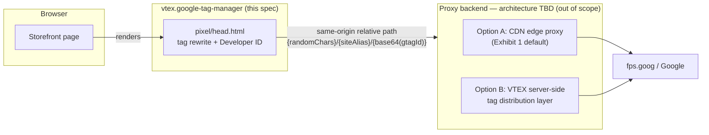

# Google Tag Gateway (GTG) Integration

> **Status**: Draft
> **Created**: 2026-09-15

## 1. Business Context

### Problem Statement

The `vtex.google-tag-manager` app loads Google Tag Manager (GTM) as a classic third-party (3P) script: the browser fetches `https://www.googletagmanager.com/gtm.js` directly (`pixel/head.html`). Ad blockers, Safari ITP, and similar browser restrictions increasingly block this call, causing signal loss — broken attribution, returning visitors misread as new sessions, and degraded Smart Bidding/PMax optimization for merchants relying on GTM/GA4 through this app.

Google's Tag Gateway (GTG) program addresses this by making the tag first-party (1P): the browser requests the script from the store's own domain instead of `googletagmanager.com`, and a proxy (its architecture is intentionally not finalized — see Decision 1) forwards the request to Google. This is a transport change only; it does not add new data collection beyond what the store's existing GTM container already captures.

Separately, and independently of GTG, Google requires a "Developer ID" to be present on VTEX-originated tag installations, so Google can attribute adoption to the VTEX platform (contractually restricted from being used to infer VTEX's market share).

This is one deliverable inside a larger 3-year commercial agreement between VTEX and Google; commercial terms (milestone payments, activation bonuses) are context for prioritization and are not implemented by this app — they are noted here only where they shape a technical requirement.

### Goals

- Store Framework merchants using this app can serve their GTM tag as first-party without editing storefront code ("codeless" setup, per contract Exhibit 1).
- Existing GTM event capture (page views, enhanced ecommerce events, GA4 events) is unaffected — `dataLayer` contents and event modules in `react/modules/*` do not change.
- GTG can be enabled per store/binding and rolled back per store/binding without a global app change, satisfying the contractual rollout/rollback requirement (Exhibit 2).
- If the 1P route is unavailable, the store falls back to the classic 3P tag automatically, so tracking is never fully lost.
- Developer ID is present on tag loads from this app, independent of whether GTG is enabled for that store.
- Meets the milestone gate for "GTG development complete, released for Google/VTEX testing" (Contract Milestone 1) for the Store Framework surface.

### User Stories

#### US-1: Merchant tag served first-party

- **Story**: As a merchant using the VTEX Google Tag Manager app, I want my GTM tag to load from my own domain instead of `googletagmanager.com`, so that ad blockers and browser ITP do not block my analytics and conversion tracking.
- **Acceptance Criteria**:
  - **Given** GTG is enabled for a store, **when** the storefront renders `pixel/head.html`, **then** the GTM script `src` is rewritten to a same-origin, relative path following the `{randomChars}/{siteAlias}/{base64(gtagId)}` format instead of `https://www.googletagmanager.com/gtm.js?id=...`.
  - **Given** GTG is enabled, **when** the script loads successfully, **then** `window.dataLayer` and all existing event modules (`enhancedEcommerceEvents`, `extraEvents`, `legacyEvents`, GA4 events) behave exactly as they do today — no event, trigger, or payload shape changes.
  - **Given** GTG is disabled for a store (default), **when** the page renders, **then** behavior is byte-for-byte identical to the current 3P implementation.

#### US-2: Codeless enablement

- **Story**: As a merchant, I want to adopt GTG without editing any storefront code, so that I don't need developer resources to benefit from it.
- **Acceptance Criteria**:
  - **Given** a store already has `gtmId` configured, **when** GTG is turned on for that store (see Decision 2 on who controls this), **then** no change to the merchant's GTM container, theme, or custom code is required.

#### US-3: Fail-open to classic 3P tag

- **Story**: As a merchant, I want my analytics to keep working even if the first-party route breaks, so that a proxy incident doesn't cause total tracking loss.
- **Acceptance Criteria**:
  - **Given** GTG is enabled and the 1P route becomes unhealthy, **when** the platform detects this, **then** affected stores revert to the classic 3P `googletagmanager.com` script within the contractual 24-hour window (Exhibit 2).
  - **Given** a rollback is triggered for a single store, **when** the rollback is applied, **then** only that store is affected — other stores with GTG enabled are not impacted.

#### US-4: Developer ID on every tag load

> **Resolved, 2026-09-29** — see Open Question 1 and Decision 3 below. For stores *not* on GTG,
> this story is **already satisfied today, by a different repository, with no code change in
> this app** — see the confirmed mechanism before implementing anything here. For stores *on*
> GTG, this story has a real, previously-unflagged gap — see the new risk under Decision 3.

- **Story**: As VTEX platform engineering, I want a Developer ID present on every GTM tag load originated by this app, so that Google can attribute the installation to the VTEX platform per the contract.
- **Acceptance Criteria**:
  - **Given** GTG is *not* enabled for a store, **when** `pixel/head.html` renders its unmodified `googletagmanager.com` loader, **then** the Developer ID is already present on the tag load — delivered by `vtex/pixel-server`, not by this app (confirmed; see Decision 3).
  - **Given** GTG *is* enabled for a store and the script `src` has been rewritten to the same-origin 1P path, **when** the page renders, **then** the Developer ID must still be present on the tag load — this is **not yet guaranteed** by anything built so far (see the new risk under Decision 3) and needs an explicit answer before US-1 ships to any real store.
  - **Given** the Developer ID value has not yet been provided by Google, **when** `pixel/head.html` renders, **then** nothing breaks — the identifier is simply omitted (no hardcoded placeholder is shipped by this app; see Decision 3 for why a placeholder shipped elsewhere is fine).

### Key Scenarios

| Scenario | Pre-conditions | Steps | Expected Result |
|---|---|---|---|
| Happy path — GTG enabled | Store on Store Framework, `gtmId` configured, GTG flag on for this store | Storefront page loads | Script tag points to the 1P relative path; GTM loads and fires events exactly as before; Developer ID present |
| Error case — 1P route unhealthy | GTG enabled, proxy backend (external to this app) failing health checks | Page loads while proxy is down | Fallback mechanism serves the classic 3P script within the 24h SLA window; store keeps collecting data via 3P in the interim |
| Edge case — GTG disabled, no `gtmId` set | App installed, `gtmId` empty | Page loads | Existing behavior preserved: console warning logged, no script injected (unchanged from today) |

### Functional Requirements

- Rewrite the GTM script tag's `src` in `pixel/head.html` to a same-origin relative path in the `{randomChars}/{siteAlias}/{base64(gtagId)}` format when GTG is enabled for the store.
- Base64-encode the configured `gtmId` client-side at render time (template substitution, consistent with how `settings.gtmId` is already interpolated today).
- Preserve the existing `dataLayer` initialization, `gtm.blacklist` push, and all event-forwarding modules unchanged.
- Support enabling/disabling GTG per store/binding independently (this app is already `bindingBounded`).
- Inject the Developer ID into the tag load path once VTEX receives the value from Google; source the value from app-level configuration, not a hardcoded literal, so it can be updated without assuming a specific release cadence.
- Preserve the current fallback behavior (log a warning, skip injection) when required configuration is missing.

### Non-Functional Requirements

- **Backwards compatibility**: with GTG disabled (default), output must be identical to the current shipped behavior. This ships as a semver-minor release per this repo's existing changelog convention.
- **Resilience**: the client-side rewrite must not introduce a single point of failure — if GTG-related configuration is absent or invalid, the app must fall back to the current 3P snippet rather than omit tracking entirely.
- **Performance**: no additional render-blocking work; the script tag remains `async`, and base64 encoding of a short ID is negligible at template-render time.
- **NFR-O11y**: N/A for this repository — this app only rewrites a client-side script tag and injects a static identifier; it introduces no new HTTP endpoints, workers, consumers, or outbound service calls. The GTG proxy component (architecture pending — Decision 1) will independently need to satisfy the Observability golden path (`https://github.com/vtex/diagnostics`) once its architecture is defined; that work is tracked as a dependency of this feature, not delivered by it.
- **Privacy**: no new data is collected by this app; the merchant remains the data controller (per contract §10). This app does not alter Google Consent Mode behavior — consent enforcement happens inside the Google tag itself.

### Out of Scope

- Implementing the GTG proxy/reverse-proxy itself (request forwarding to `fps.goog`, header injection, IP-to-geo resolution, cache bypass, SLA compliance). This is a separate, not-yet-assigned architecture effort — see Decision 1.
- Storefronts other than Store Framework (Fast Store, headless, fully custom themes, Activity Flow). Per the source brief, these are excluded from the initial pilot and have no defined owner yet.
- The Data Manager API (DMA) integration — a separate, lower-priority line item in the same contract.
- Any change to Google Consent Mode handling, PII redaction, or Enhanced Conversions — these are Google-side tag behaviors, not part of this app.
- Deciding between the "big-bang" (default-on) and phased activation models from the contract (§3) — this is a product/legal decision; this spec's design supports either outcome (see Decision 2).

---

## 2. Arch Decisions

### Proposed Solution

Extend `pixel/head.html` (and its supporting settings) with a conditional path: when GTG is enabled for a store, rewrite the GTM script tag to a same-origin relative URL following Google's required format instead of the current absolute `googletagmanager.com` URL. All event-capture code (`react/modules/*`) is untouched, since GTG changes transport, not data collection.

Deliberately, this app does not implement, call, or assume anything about the proxy that will actually receive that request. Google's own requirement that the script be "same-origin" means the browser-visible contract is just a relative path — whatever infrastructure answers that path (CDN edge rule, dedicated microservice, or a broader server-side tag distribution layer) is an integration boundary this app depends on, not something it implements.

### Architecture Overview



The dotted boundary matters more than the diagram's boxes: this repository owns everything left of "same-origin relative path." Everything to the right is an external dependency whose internal shape can change without requiring a new spec for this app, as long as it keeps answering at a same-origin path.

### Alternatives Considered

| Alternative | Pros | Cons | Verdict |
|---|---|---|---|
| Hardcode the rewrite to assume Option A (CDN edge proxy) now | Matches Google's Exhibit 1 wording literally; simplest to reason about today | Couples this app to an infrastructure decision that isn't made yet; likely rework if Option B (custom server-side tag layer) is chosen | Rejected |
| Decouple via a same-origin relative path, agnostic to backend (chosen) | Works under either Option A or B; matches the "same-origin" requirement Google already mandates; minimal, reversible change | Still depends on *some* team eventually serving that path correctly | Accepted |
| Block this app's work until the proxy architecture decision is made | Zero risk of rework | Blocks the Milestone 1 gate ("GTG development complete"), which includes the client-side deliverable | Rejected |

### Risks & Mitigations

| Risk | Impact | Likelihood | Mitigation |
|---|---|---|---|
| Developer ID value not yet received from Google | Medium | High (contract itself states it's pending) | Not this app's problem to solve — see Decision 3. `vtex/pixel-server` already ships a placeholder (`dVTEX01`) behind the same real-value-pending condition; no independent placeholder needed here |
| **GTG's own URL rewrite (US-1) silently breaks Developer ID coverage for exactly the stores that just adopted it** | High | High once US-1 ships to any real store | New — see Decision 3 addendum. `pixel-server`'s Developer ID detection (`vtex/pixel-server#88`) is a content-based regex anchored to `googletagmanager.com`; the moment this app rewrites `pixel/head.html`'s script `src` to a same-origin relative path, that regex stops matching and the Developer ID bootstrap silently stops being emitted — a regression, not a no-op, and invisible without deliberate testing |
| Proxy backend location/architecture undecided | High | High | Keep this app's contract limited to emitting a same-origin relative path (Decision 1); do not assume routing internals |
| Ambiguity on whether GTG enablement is a merchant-facing toggle or a platform-controlled rollout flag | Medium | Medium | Default to platform-controlled rollout (Decision 2); escalate to product before building any new admin UI |
| Contract's "1P as default behavior" requirement (§6.1) vs. the phased/gradual rollout already being pursued (§3, §8) | High | Medium | Not resolved by this spec — flagged as Open Question 2 for the contract/product owner before GA |
| Legal/privacy review of CDN interception still pending | High | Medium | Treat as a GA-blocking dependency, not an engineering task in this repo |

### Key Decisions

#### Decision 1: The proxy backend architecture is an external, deferred dependency

- **Status**: Deferred (owned outside this repository)
- **Context**: The source brief explicitly states the proxy's home is undecided — it could be a CDN edge rule (Option A, Google's documented default) or a broader VTEX server-side tag distribution layer (Option B), and the decision has a named but unconfirmed technical owner outside this app's team.
- **Decision**: This app implements only its side of the contract: rendering a same-origin relative path in the format Google requires. It does not implement, mock, or hardcode assumptions about what serves that path.
- **Consequences**: This app can ship and pass Milestone 1 for its own scope independent of the proxy decision. The trade-off is that end-to-end GTG only works once the proxy exists somewhere; until then, the rewritten path safely 404s or should stay behind the enablement flag from Decision 2.

#### Decision 2: GTG enablement is modeled as a platform-controlled rollout flag, not a new merchant setting

- **Status**: Accepted (assumption — see Open Question 2)
- **Context**: Exhibit 2 requires per-store test/launch/rollback capability. Sections 3 and 8 of the source brief indicate engineering is already building toward a phased, gradual rollout rather than the contract's alternative "big-bang" default-on model.
- **Decision**: Model enablement as an internal rollout control (e.g., a feature flag evaluated per store/binding), not a new field in `settingsSchema`. The merchant-facing configuration surface (`gtmId`, `allowCustomHtmlTags`, `sendGA4Events`) does not change.
- **Consequences**: Merchants get GTG transparently once their store is included in the rollout; no new admin UI is required, which keeps setup "codeless" per Exhibit 1. If product later decides merchants should be able to opt in/out themselves, a new setting can be added without touching the core rewrite logic.

#### Decision 3: Developer ID is a platform constant, not a merchant-configurable setting

- **Status**: **Superseded for non-GTG stores (confirmed 2026-09-29) — no work needed in this repo for that case.** Still open for GTG-enabled stores; see the addendum below.
- **Context**: The Developer ID is a single static value assigned by Google to VTEX as a platform, not something that varies per merchant. Originally this spec assumed *this app* would need to inject it.
- **Confirmed finding, resolving Open Question 1 for non-GTG stores**: `vtex/pixel-server#88`
  (`feat/google-tag-developer-id`) already ships and has validated in production
  (`storetheme.vtex.com`) a content-based rewrite, `withGoogleDeveloperId`, that prepends
  `gtag('set','developer_id.<id>',true)` immediately before **any** snippet it serves that
  matches `/googletagmanager\.com\/(?:gtm\.js|gtag\/js)/`. This app's own `manifest.json`
  declares `"policies": [{"name": "pixel"}]` and `"pixel": "0.x"`, which is exactly the build
  feature pixel-server filters on to decide which apps' snippets it serves through its `pixels`
  route — and this app's current `pixel/head.html` loader line
  (`'https://www.googletagmanager.com/gtm.js?id='+i+dl`) matches that regex. **So every store on
  this app that is not on GTG already gets the Developer ID stamped today, with zero code change
  here.** The placeholder value in production is `dVTEX01` — use that exact literal if this app
  ever needs its own copy (see the addendum), not an independently invented one, so Google's
  aggregate adoption signal stays consistent across surfaces during the pending-real-ID period.
- **Addendum — the part of Open Question 1 this does NOT resolve, and a new decision it forces:**
  pixel-server's regex is anchored to the literal string `googletagmanager.com`. Once US-1 ships
  and rewrites `pixel/head.html`'s script `src` to a same-origin relative path for a GTG-enabled
  store, that regex **stops matching**, and pixel-server silently stops emitting the Developer ID
  bootstrap for exactly the stores that just adopted GTG — the population Google most wants
  attributed, since Exhibit 1 §6.2 defines a *separate* delivery mechanism for them
  (`X-Gtg-Developer-Id`, added by the proxy) that does not exist yet because the proxy itself
  does not exist yet (Decision 1). Between "GTG enabled" and "proxy ships the header," a
  GTG-enabled store has **no** Developer ID coverage at all — worse than today, not neutral.
  **Decision**: when this app rewrites the script `src` for a GTG-enabled store (US-1), it must
  also independently emit its own copy of the identical bootstrap
  (`gtag('set','developer_id.<id>',true)`, same value, same app-level config source as pixel-server's)
  directly in `pixel/head.html`, immediately before the rewritten loader — not because this app
  owns Developer ID in general (it doesn't; Decision 3's main body still stands for the ~96%+ of
  stores not on GTG), but as a defensive measure so GTG-enabled stores are never worse off than
  before they adopted it. Once the proxy reliably sends `X-Gtg-Developer-Id` (confirmed via
  Exhibit 1 §6.3's health checks), this client-side duplicate becomes redundant-but-harmless (a
  repeated identical `gtag('set',...)` call is a no-op) and can be removed in a later release —
  shipping it now costs one string concatenation and closes a real regression window.
- **Consequences**: No merchant ever sees or configures this value in either case. For non-GTG
  stores, a single config change in `pixel-server` updates every store once Google provides the
  real ID — nothing to do here. For GTG-enabled stores, this app needs the same value available
  at render time (app-level config, per the main decision) so its defensive copy stays in sync
  with pixel-server's, without the two ever needing to coordinate a deploy.

### Implementation Plan

1. **Phase 1 — Internal release (Contract Milestone 1)**: Implement the conditional script-tag rewrite and Developer ID injection, both disabled/no-op by default. Ship behind the rollout flag from Decision 2, enabled only for VTEX/Google internal test sites.
2. **Phase 2 — Customer testing (toward Milestone 2)**: Enable the flag for the agreed Store Framework pilot cohort. This app's only responsibility here is that the rewritten path resolves once the (still separately-owned) proxy exists; the `/healthy` and `/?validate_geo=healthy` checks from Exhibit 1 §6.3 are the proxy's responsibility, not this app's.
3. **Phase 3 — Ramp to GA (Milestone 3)**: Expand flag rollout percentage per the agreed ramp schedule, store by store, using the same per-store rollback capability from Decision 2.
4. **Phase 4 — Post-GA**: Investigate Fast Store, headless, and Activity Flow coverage as a separate initiative (no owner assigned yet per the source brief).

---

## 3. Technical Contract

### Data Models

No persistent data models are introduced. The only structured input is the existing `settingsSchema` in `manifest.json` (`gtmId`, `allowCustomHtmlTags`, `sendGA4Events`), which is unchanged by this feature.

### Interfaces

- **`pixel/head.html` template variables** (existing, unchanged): `{{settings.gtmId}}`, `{{settings.sendGA4Events}}`, `{{ blacklist }}`.
- **New internal contract**: a same-origin relative URL emitted by this app in place of the current absolute script `src`:
  ```
  /{randomChars}/{siteAlias}/{base64(gtagId)}
  ```
  `randomChars` and `siteAlias` are provided by whatever serves the proxy side (Decision 1); this app is responsible only for base64-encoding `gtmId` and composing the path, not for generating or validating the other two segments.
- **`window.dataLayer`**: unchanged. All existing pushes (`gtm.blacklist`, GTM's own `gtm.start` event) and all event modules under `react/modules/` keep their current shape and are unaffected by the transport change.

### Integration Points

- **VTEX Pixel Manager** (`vtex.pixel-interfaces`, existing `pixel` policy): unchanged; this app continues to listen for the same `PixelMessage` events via `window.addEventListener('message', handleEvents)`.
- **GTG proxy backend** (external, architecture pending — Decision 1): this app's only integration surface with it is the relative URL format above. No direct calls, health checks, or header injection are implemented in this repository.
- **Rollout/feature-flag mechanism** (Decision 2): to be wired once the specific platform mechanism is confirmed with product; not yet part of this app's dependencies.

### Invariants & Constraints

- With GTG disabled, output is byte-for-byte identical to the current 3P implementation — no regression for the ~96% of non-headless stores not in the initial pilot.
- The base64-encoded `gtagId` segment must stay within the 100-character path limit implied by Google's format (Exhibit 1 §6.1); given typical `GTM-XXXXXXX` / `AW-XXXXXXXXXX` ID lengths, this is not expected to be a practical constraint but should be validated once real IDs are tested end-to-end.
- Developer ID injection must be a no-op (not a broken placeholder) whenever the value is unset.
- `dataLayer` semantics, event names, and payload shapes defined in `react/modules/*` must never change as a side effect of this feature — GTG is a transport change only.

---

## Open Questions

1. ~~**Developer ID delivery mechanism for non-GTG stores.**~~ **Resolved, 2026-09-29 — see
   Decision 3.** Confirmed empirically, not by assumption: non-GTG stores get Developer ID via
   `vtex/pixel-server#88`'s content-based `gtag('set',...)` bootstrap, already shipped and
   validated in production, with zero code needed in this app. GTG-enabled stores need the
   `X-Gtg-Developer-Id` header from the (not-yet-built) proxy per Exhibit 1 §6.2 *or* this app's
   own defensive fallback bootstrap (Decision 3 addendum) until that header is proven reliable.
2. **Activation model impact on this app's rollout mechanism.** If VTEX ultimately accepts the contract's "big-bang" default-on model (§3) instead of the phased rollout assumed in Decision 2, this app's enablement mechanism would need to change from a gradual rollout flag to an unconditional default — a product/legal decision, not an engineering one, tracked here so it isn't lost.

## Cross-repo context

This app's GTG work is one of (at least) two independent implementations of the same Google
initiative, in genuinely disjoint rendering pipelines:

- [`vcs.checkout-ui#1697`](https://github.com/vtex/vcs.checkout-ui/pull/1697) (`feat/gtg-migration`)
  — the Portal + checkout SDD, covering Portal-rendered pages (checkout v5/v6, `orderPlaced`),
  which this app's `pixel/head.html` never touches.
- [`pixel-server#88`](https://github.com/vtex/pixel-server/pull/88) — real shipped code this
  spec now depends on directly for non-GTG Developer ID coverage (Decision 3).

**Deliberate difference, not an inconsistency to fix**: the checkout spec keeps the 1P and 3P
scripts permanently coexisting (no rollout flag), backed by a dedup key, rather than this app's
flag-gated replace-with-fallback model (Decision 2). Checkout fires a small number of very
high-value events per session (`begin_checkout`, `add_payment_info`, `purchase`), where even a
24h fail-open gap during a proxy incident is judged an unacceptable loss — worth the extra
dedup-key/telemetry cost. This app's storefront traffic is dominated by high-volume, low-value
events (`page_view`, `scroll`, `session_start`), where a flag + time-boxed fallback is the
better trade, and permanently double-proxying every page view would be a real cost for little
benefit. Both specs record this explicitly so neither gets "corrected" to match the other later
without this context.
